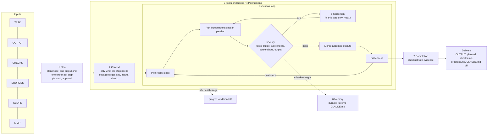

# VOLT harness

A task runs inside a harness, not one long chat. The harness is the plan, the context, the tools, the checks and the
rules around the model. Interactive diagram: <https://claude.ai/artifact/CxjyYynhQyEbAeefoQ5XHp> (private to the owner).

## Architecture

## Where each layer lives in the stack

| Layer | Provided by |
|---|---|
| 1 Plan | Claude Code plan mode; Superpowers brainstorm and plan |
| 2 Context | Subagents (VOLT agents, ECC reviewers); ECC memory skill |
| 3 Tools and hooks | ECC hooks runtime; project scripts listed in CLAUDE.md |
| 4 Permissions | Claude Code permission rules and sandbox; ECC security skills (`safety-guard`, `gateguard`) |
| 5 Verification | Superpowers TDD and verification; `checks.md` |
| 6 Feedback | Correction loop capped at three; durable rules in CLAUDE.md |
| 7 Completion and delivery | Completion checklist; Anthropic document skills for client files |
| Behaviour throughout | Karpathy rules |

## Wired into every project

- `/volt:harness <task>` runs the full prompt ([`plugins/volt/commands/harness.md`](../../plugins/volt/commands/harness.md)).
  It asks once for any missing input (output, checks, sources, scope, limit).
- [`plugins/volt/memory/harness-rules.md`](../../plugins/volt/memory/harness-rules.md) is the short always-on version.
  `scripts/volt/setup-stack` (or `scripts/volt/install-memory` on its own) copies it to `~/.claude/volt-harness.md`
  and adds one import line to `~/.claude/CLAUDE.md`, Claude Code's user memory, which loads in every project. Re-running
  is safe: the import is added once, and an existing `CLAUDE.md` is backed up first and never overwritten.
- Runs keep `plan.md`, `checks.md` and `progress.md` next to the work, so any session can resume from the recorded
  next action.
