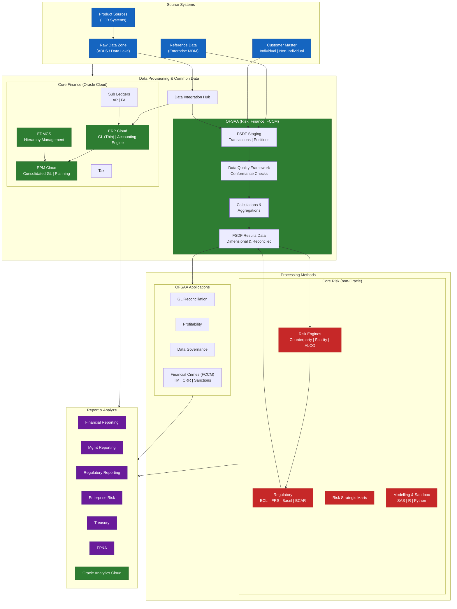

# FRP Reference Architecture — Canonical Pattern

## Mermaid Diagram Template (Target State)

Use this template when generating architecture diagrams for financial services clients.
Replace placeholders with client-specific system names.



## HTML Architecture Diagram Template

For generating SVG/HTML architecture diagrams:

```html
<!-- Financial Services FRP Architecture — 4-Layer Horizontal -->
<!-- Replace {CLIENT}, {SYSTEM_NAMES} with client-specific values -->

<svg viewBox="0 0 1200 700" xmlns="http://www.w3.org/2000/svg" font-family="Segoe UI, Arial">
  <!-- Layer Headers -->
  <rect x="0" y="0" width="200" height="700" fill="#1565C0" rx="4"/>
  <text x="100" y="350" fill="#fff" font-weight="700" text-anchor="middle" transform="rotate(-90 100 350)">SOURCE</text>

  <rect x="210" y="0" width="450" height="700" fill="#2E7D32" rx="4" opacity="0.1"/>
  <text x="435" y="25" fill="#2E7D32" font-weight="700" text-anchor="middle">DATA PROVISIONING & COMMON DATA</text>

  <rect x="670" y="0" width="270" height="700" fill="#C62828" rx="4" opacity="0.1"/>
  <text x="805" y="25" fill="#C62828" font-weight="700" text-anchor="middle">PROCESSING METHODS</text>

  <rect x="950" y="0" width="250" height="700" fill="#6A1B9A" rx="4" opacity="0.1"/>
  <text x="1075" y="25" fill="#6A1B9A" font-weight="700" text-anchor="middle">REPORT & ANALYZE</text>

  <!-- Source boxes, Provisioning boxes, Processing boxes, Reporting boxes -->
  <!-- ... populate per client ... -->
</svg>
```

## OSFI Regulatory Requirements Reference

When designing regulatory architecture for Canadian financial institutions:

| OSFI Guideline | Coverage | Oracle Component |
|---|---|---|
| BCAR (Basel Capital Adequacy) | Capital ratios, RWA | OFSAA Regulatory Capital |
| B-20 (Mortgage Underwriting) | Residential mortgage risk | Risk Engines |
| B-6 (Liquidity) | LCR, NSFR | OFSAA Liquidity Risk |
| IFRS 9 (ECL) | Expected Credit Loss | OFSAA ECL |
| IFRS 17 (Insurance) | Insurance contract measurement | OFSAA Insurance |
| E-23 (Model Risk) | Model validation, governance | Model Lifecycle Mgmt |
| AML/ATF | Transaction monitoring, sanctions | OFSAA FCCM |

## Data Flow Patterns by Module

### GL Flow: Source → OFSAA → ERP Cloud
```
LOB Transaction → FSDF Staging → Accounting Rules →
Thick Ledger (Detail) → Thin GL (Summary) → EPM Consolidation
```

### Risk Flow: Source → OFSAA → Risk Engines → Results
```
Positions/Exposures → FSDF → OFSAA Risk Processing →
PD/LGD Calculation → Regulatory Capital → BCAR Return
```

### Reconciliation Flow
```
FSDF Results (Finance) ←→ GL Balances (ERP Cloud)
FSDF Results (Risk) ←→ Risk Engine Outputs
Sub-Ledger Totals ←→ GL Control Accounts
```
