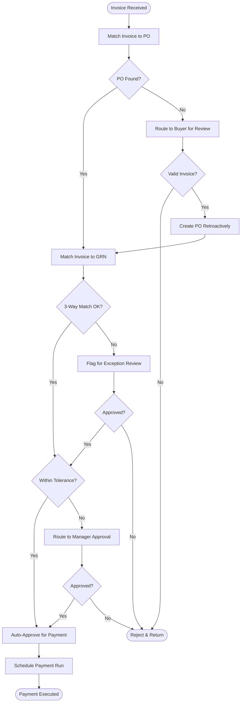
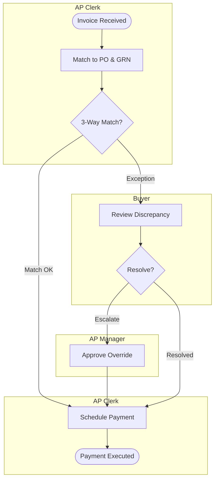

# Process Flow Generator

This skill provides automated assistance for process flow generator tasks within the Visual Content domain. It turns process descriptions, requirements, and narratives into production-ready visual diagrams — Mermaid flowcharts, swim-lane layouts, SIPOC charts, and hierarchical process taxonomies.

## When to Use This Skill

This skill activates automatically when you:

- Mention "process flow generator" in your request
- Ask about process flow generator patterns or best practices
- Need help with visual content skills covering diagrams, charts, presentations, and visual documentation tools
- Describe a business process and need it visualized
- Request swim-lane, SIPOC, RACI, or cross-functional diagrams
- Need L1-L5 process decomposition for finance transformation
- Want to generate Mermaid syntax for embedding in documentation or Streamlit UIs
- Ask for current-state vs. future-state process comparison diagrams

## What This Skill Does

1. **Parses Process Descriptions**: Extracts steps, decision points, roles, and handoffs from narrative text
2. **Generates Mermaid Diagrams**: Produces valid Mermaid flowchart, sequence, and Gantt syntax ready for rendering
3. **Builds Swim-Lane Layouts**: Creates cross-functional diagrams showing persona responsibilities (Requestor, Approver, Buyer, AP Clerk, Controller, etc.)
4. **Applies Finance Taxonomy**: Maps processes to the L1-L5 hierarchy — R2R, P2P, O2C, Fixed Assets, Planning & Budgeting, Reporting & Analytics
5. **Follows Best Practices**: Uses standard BPM shapes (rectangles for tasks, diamonds for decisions, rounded for start/end, parallelograms for I/O)
6. **Validates Outputs**: Checks Mermaid syntax correctness, ensures all branches terminate, and flags orphan nodes
7. **Supports Multiple Formats**: Flowcharts, sequence diagrams, state diagrams, SIPOC tables, and RACI matrices

## How to Use

### Basic Flowchart

```
Generate a process flow for the month-end close process
```

### Swim-Lane Diagram

```
Create a swim-lane diagram for the Purchase-to-Pay process showing
Requestor, Approver, Buyer, and AP Clerk lanes
```

### L1-L5 Decomposition

```
Break down the Record-to-Report process from L1 to L4 with a visual
hierarchy diagram
```

### Current vs. Future State

```
Show current-state vs. future-state process flow for invoice processing,
highlighting automation opportunities
```

### SIPOC Chart

```
Generate a SIPOC diagram for the Order-to-Cash process
```

## Example

**User**: "Generate a Mermaid flowchart for the 3-way match invoice approval process"

**Output**:


**With swim lanes**:


## Supported Process Domains

| Domain | L1 Processes | Common Flows |
|--------|-------------|--------------|
| **Record-to-Report** | Journal Entry, Reconciliation, Close, Consolidation | Month-end close, Intercompany elimination, GL posting |
| **Procure-to-Pay** | Requisition, Sourcing, PO, Receipt, Invoice, Payment | 3-way match, Supplier onboarding, Payment run |
| **Order-to-Cash** | Order, Fulfillment, Billing, Collection, Cash Application | Quote-to-order, Revenue recognition, Dunning |
| **Fixed Assets** | Acquisition, Capitalization, Depreciation, Disposal | CIP-to-asset, Impairment testing, Asset transfer |
| **Planning & Budgeting** | Strategic Planning, Forecasting, Budgeting | Rolling forecast, Driver-based planning, What-if |
| **Reporting & Analytics** | Statutory, Management, Regulatory, Ad-hoc | Board reporting, OSFI returns, KPI dashboards |

## Tips

- Specify the audience (technical vs. executive) to adjust detail level
- Include role names for automatic swim-lane generation
- Reference L1-L5 levels to control decomposition depth
- Use "current state" and "future state" keywords for comparison diagrams
- Add "with KPIs" to overlay cycle time, error rate, or cost metrics on the flow
- Mermaid output can be directly embedded in Streamlit via `st.markdown()`
- For large processes, request L2 overview first, then drill into L3/L4 sub-processes

## Related Skills

- **Canvas Design** — For broader visual design and layout composition
- **Creative Designer** — Executive dashboard mockups and C-suite presentations
- **Rapid Prototyper** — Quick interactive demos of process flows
- **Process Flows Module** — VOLT's built-in L1-L5 taxonomy browser and visual flow renderer
