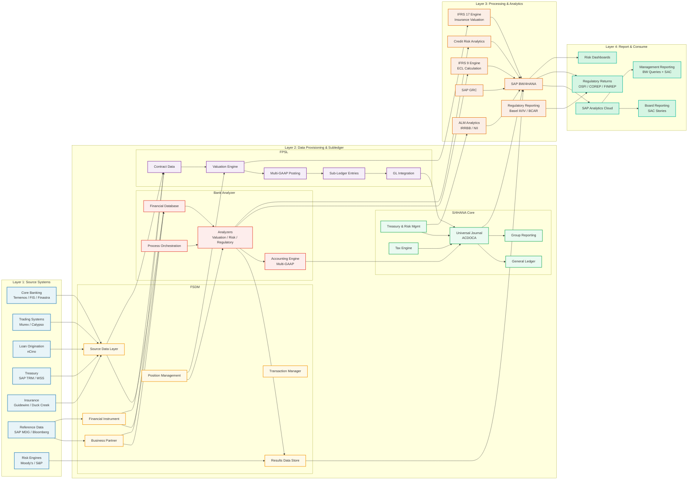
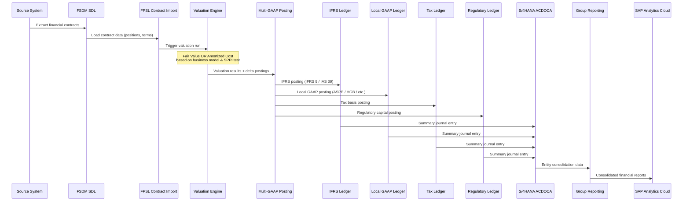
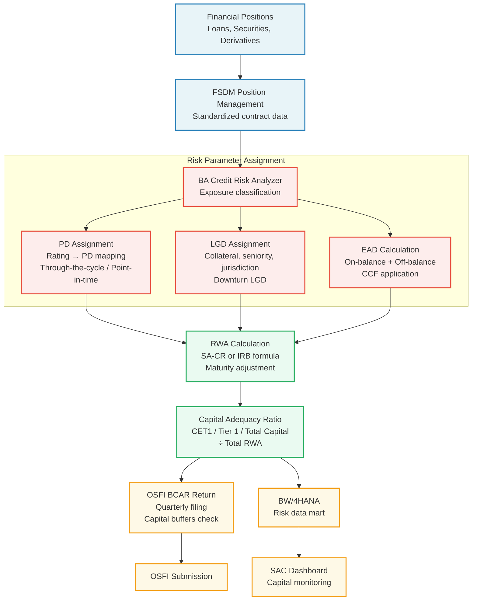
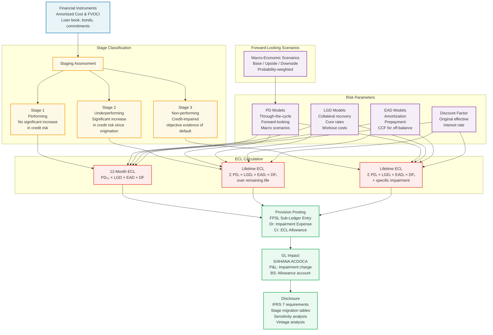

# SAP Finance & Risk Platform — Reference Architecture

Reference diagrams, data flow patterns, and visual templates for SAP S/4HANA Banking,
Bank Analyzer, and FPSL architecture deliverables.

---

## 1. SAP FRP Target State — Mermaid Diagram



---

## 2. FPSL Data Flow Pattern

### Narrative Flow

```
Source System → FSDM SDL → FPSL Contract Import →
Valuation (Fair Value / Amortized Cost) → Multi-GAAP Posting Rules →
IFRS Ledger + Local GAAP Ledger + Tax Ledger + Regulatory Ledger →
Summary Posting → S/4HANA ACDOCA → Group Reporting → SAC
```

### Mermaid Sequence Diagram



### Detailed Steps

| Step | Component | Detail |
|---|---|---|
| 1. Extract | Source System → FSDM SDL | Batch or real-time extraction of financial contracts, positions, and market data |
| 2. Import | FSDM SDL → FPSL | Contract data loaded into FPSL with product classification, counterparty links |
| 3. Classify | FPSL | Business model test (hold-to-collect, HTC&S, trading) and SPPI test for IFRS 9 |
| 4. Valuation | Valuation Engine | Fair value (mark-to-market/model), amortized cost (effective interest rate), or FVOCI |
| 5. Posting Rules | Multi-GAAP Posting | Each GAAP has distinct posting rules: recognition, measurement, impairment, derecognition |
| 6. IFRS Posting | IFRS Ledger | IFRS 9 measurement, ECL provision, hedge accounting adjustments |
| 7. Local GAAP | Local GAAP Ledger | Canadian ASPE, German HGB, US GAAP, etc. — separate measurement rules |
| 8. Tax Posting | Tax Ledger | Tax basis adjustments, deferred tax implications |
| 9. Regulatory | Regulatory Ledger | Regulatory capital treatment, Basel classification |
| 10. Summary | → S/4HANA ACDOCA | Aggregated postings by account, profit center, segment into Universal Journal |
| 11. Consolidation | Group Reporting | Intercompany elimination, currency translation, minority interest |
| 12. Reporting | SAC | Financial statements, management reports, regulatory disclosures |

---

## 3. Basel Calculation Chain

### Narrative Flow

```
Positions → FSDM → BA Credit Risk Analyzer →
PD/LGD/EAD Assignment → RWA Calculation →
Capital Adequacy Ratio → OSFI BCAR Return
```

### Mermaid Flow Diagram



### Basel III/IV Approaches Supported

| Approach | Method | SAP Component |
|---|---|---|
| **SA-CR** (Standardized) | Prescribed risk weights by asset class | BA Credit Risk Analyzer |
| **F-IRB** (Foundation IRB) | Bank-estimated PD, supervisory LGD/EAD | BA + internal PD models |
| **A-IRB** (Advanced IRB) | Bank-estimated PD, LGD, EAD | BA + full internal models |
| **SA-CVA** | Standardized CVA charge | BA Market Risk |
| **BA-CVA** | Basic CVA approach | BA Market Risk |
| **SA-CCR** | Standardized counterparty credit risk | BA Counterparty Risk |
| **Output Floor** | 72.5% of SA-CR (Basel IV) | BA Capital Calculator |

---

## 4. IFRS 9 ECL Flow

### Narrative Flow

```
Financial Instruments → Staging Assessment (1/2/3) →
12-month ECL (Stage 1) or Lifetime ECL (Stage 2/3) →
PD × LGD × EAD × Discount Factor →
Provision Posting → GL Impact → Disclosure
```

### Mermaid Flow Diagram



### Staging Criteria Detail

| Criterion | Stage 1 → 2 Trigger | Stage 2 → 3 Trigger |
|---|---|---|
| **Quantitative** | PD increase > threshold (e.g., 2x origination PD) | 90 days past due |
| **Qualitative** | Watchlist, forbearance, sector deterioration | Bankruptcy, fraud, restructuring |
| **Backstop** | 30 days past due (rebuttable presumption) | 90 days past due (rebuttable) |
| **Macro-overlay** | Forward-looking scenario deterioration | N/A — already impaired |

### ECL Formula Components

| Parameter | Stage 1 | Stage 2 | Stage 3 |
|---|---|---|---|
| **PD** | 12-month marginal PD | Lifetime cumulative PD curve | 100% (already defaulted) |
| **LGD** | Downturn / through-the-cycle LGD | Lifetime LGD (cure/workout) | Specific LGD (recovery estimate) |
| **EAD** | Current exposure + CCF | Projected exposure profile | Current exposure |
| **Discount** | Original EIR | Original EIR | Original EIR (credit-adjusted) |
| **Scenarios** | Probability-weighted (3+ scenarios) | Probability-weighted (3+ scenarios) | Case-by-case or scenario-weighted |

---

## 5. HTML/SVG Architecture Diagram Template

Use this template to generate visual architecture diagrams for client deliverables.

```html
<!DOCTYPE html>
<html lang="en">
<head>
    <meta charset="UTF-8">
    <meta name="viewport" content="width=device-width, initial-scale=1.0">
    <title>SAP Finance & Risk Platform — Target State Architecture</title>
    <style>
        * { margin: 0; padding: 0; box-sizing: border-box; }
        body { font-family: 'Segoe UI', Tahoma, Geneva, Verdana, sans-serif; background: #f8f9fa; padding: 20px; }
        .diagram-container { max-width: 1400px; margin: 0 auto; background: white; border-radius: 12px; box-shadow: 0 4px 24px rgba(0,0,0,0.08); padding: 40px; }

        .diagram-title {
            text-align: center;
            margin-bottom: 8px;
            font-size: 24px;
            font-weight: 700;
            color: #1a1a2e;
        }
        .diagram-subtitle {
            text-align: center;
            margin-bottom: 32px;
            font-size: 14px;
            color: #666;
        }

        .architecture-grid {
            display: grid;
            grid-template-columns: 200px 320px 280px 220px;
            gap: 16px;
            align-items: start;
        }

        .layer {
            background: #fff;
            border-radius: 10px;
            padding: 16px;
            min-height: 500px;
        }

        .layer-header {
            text-align: center;
            padding: 8px 12px;
            border-radius: 6px;
            font-weight: 700;
            font-size: 13px;
            text-transform: uppercase;
            letter-spacing: 0.5px;
            margin-bottom: 12px;
        }

        /* Layer 1: Source */
        .layer-source { border: 2px solid #3498db; }
        .layer-source .layer-header { background: #3498db; color: white; }

        /* Layer 2: Data Provisioning */
        .layer-provision { border: 2px solid #e67e22; }
        .layer-provision .layer-header { background: #e67e22; color: white; }

        /* Layer 3: Processing */
        .layer-process { border: 2px solid #e74c3c; }
        .layer-process .layer-header { background: #e74c3c; color: white; }

        /* Layer 4: Report */
        .layer-report { border: 2px solid #27ae60; }
        .layer-report .layer-header { background: #27ae60; color: white; }

        .component-box {
            background: #f8f9fa;
            border: 1px solid #dee2e6;
            border-radius: 6px;
            padding: 8px 10px;
            margin-bottom: 8px;
            font-size: 11px;
            transition: all 0.2s;
        }
        .component-box:hover {
            transform: translateX(4px);
            box-shadow: 0 2px 8px rgba(0,0,0,0.1);
        }
        .component-box .comp-name {
            font-weight: 700;
            color: #1a1a2e;
            font-size: 12px;
        }
        .component-box .comp-detail {
            color: #666;
            font-size: 10px;
            margin-top: 2px;
        }

        .sub-section {
            border-left: 3px solid #dee2e6;
            padding-left: 8px;
            margin: 10px 0;
        }
        .sub-section-title {
            font-size: 11px;
            font-weight: 700;
            color: #495057;
            margin-bottom: 6px;
            text-transform: uppercase;
            letter-spacing: 0.3px;
        }

        /* Sub-section colors */
        .sub-fsdm { border-left-color: #f39c12; }
        .sub-ba { border-left-color: #e74c3c; }
        .sub-fpsl { border-left-color: #8e44ad; }
        .sub-s4 { border-left-color: #27ae60; }

        /* Cross-cutting bar */
        .cross-cutting {
            margin-top: 20px;
            display: grid;
            grid-template-columns: repeat(4, 1fr);
            gap: 8px;
        }
        .cross-cutting-item {
            background: #2c3e50;
            color: white;
            text-align: center;
            padding: 10px;
            border-radius: 6px;
            font-size: 11px;
            font-weight: 600;
        }

        /* Flow arrows (CSS-based) */
        .flow-indicator {
            display: flex;
            align-items: center;
            justify-content: center;
            color: #adb5bd;
            font-size: 20px;
            padding: 0 4px;
        }

        /* Footer */
        .footer {
            margin-top: 24px;
            padding-top: 16px;
            border-top: 2px solid #6366f1;
            display: flex;
            justify-content: space-between;
            align-items: center;
            font-size: 11px;
            color: #666;
        }
    </style>
</head>
<body>
    <div class="diagram-container">
        <div class="diagram-title">SAP Finance & Risk Platform — Target State Architecture</div>
        <div class="diagram-subtitle">S/4HANA for Financial Services | Bank Analyzer | FPSL | BW/4HANA | SAC</div>

        <div class="architecture-grid">
            <!-- Layer 1: Source Systems -->
            <div class="layer layer-source">
                <div class="layer-header">1. Source Systems</div>
                <div class="component-box">
                    <div class="comp-name">Core Banking</div>
                    <div class="comp-detail">Temenos, FIS, Finastra</div>
                </div>
                <div class="component-box">
                    <div class="comp-name">Trading Systems</div>
                    <div class="comp-detail">Murex, Calypso, Summit</div>
                </div>
                <div class="component-box">
                    <div class="comp-name">Loan Origination</div>
                    <div class="comp-detail">nCino, in-house</div>
                </div>
                <div class="component-box">
                    <div class="comp-name">Treasury</div>
                    <div class="comp-detail">SAP TRM, Wall Street Suite</div>
                </div>
                <div class="component-box">
                    <div class="comp-name">Insurance</div>
                    <div class="comp-detail">Guidewire, Duck Creek</div>
                </div>
                <div class="component-box">
                    <div class="comp-name">Reference Data</div>
                    <div class="comp-detail">SAP MDG, Bloomberg</div>
                </div>
                <div class="component-box">
                    <div class="comp-name">Risk Engines</div>
                    <div class="comp-detail">Moody's, S&P, in-house</div>
                </div>
            </div>

            <!-- Layer 2: Data Provisioning & Subledger -->
            <div class="layer layer-provision">
                <div class="layer-header">2. Data Provisioning & Subledger</div>

                <div class="sub-section sub-fsdm">
                    <div class="sub-section-title">SAP FSDM</div>
                    <div class="component-box">
                        <div class="comp-name">Source Data Layer (SDL)</div>
                        <div class="comp-detail">Raw data ingestion</div>
                    </div>
                    <div class="component-box">
                        <div class="comp-name">Business Partner / Financial Instrument</div>
                        <div class="comp-detail">Master data, KYC, terms</div>
                    </div>
                    <div class="component-box">
                        <div class="comp-name">Position Mgmt / Results Data Store</div>
                        <div class="comp-detail">Balances, exposures, calculated results</div>
                    </div>
                </div>

                <div class="sub-section sub-ba">
                    <div class="sub-section-title">Bank Analyzer</div>
                    <div class="component-box">
                        <div class="comp-name">Financial Database (FINDB)</div>
                        <div class="comp-detail">Central contract repository</div>
                    </div>
                    <div class="component-box">
                        <div class="comp-name">Analyzers + Accounting Engine</div>
                        <div class="comp-detail">Valuation, risk, multi-GAAP</div>
                    </div>
                </div>

                <div class="sub-section sub-fpsl">
                    <div class="sub-section-title">FPSL</div>
                    <div class="component-box">
                        <div class="comp-name">Contract Data + Valuation</div>
                        <div class="comp-detail">Fair value, amortized cost</div>
                    </div>
                    <div class="component-box">
                        <div class="comp-name">Multi-GAAP Posting → GL Integration</div>
                        <div class="comp-detail">IFRS, local GAAP, tax, regulatory</div>
                    </div>
                </div>

                <div class="sub-section sub-s4">
                    <div class="sub-section-title">S/4HANA Core</div>
                    <div class="component-box">
                        <div class="comp-name">Universal Journal (ACDOCA)</div>
                        <div class="comp-detail">Single source of truth</div>
                    </div>
                    <div class="component-box">
                        <div class="comp-name">GL + TRM + Group Reporting</div>
                        <div class="comp-detail">Ledgers, treasury, consolidation</div>
                    </div>
                </div>
            </div>

            <!-- Layer 3: Processing & Analytics -->
            <div class="layer layer-process">
                <div class="layer-header">3. Processing & Analytics</div>
                <div class="component-box">
                    <div class="comp-name">SAP BW/4HANA</div>
                    <div class="comp-detail">Enterprise data warehouse, cubes</div>
                </div>
                <div class="component-box">
                    <div class="comp-name">IFRS 9 Engine</div>
                    <div class="comp-detail">ECL staging, PD/LGD/EAD, lifetime ECL</div>
                </div>
                <div class="component-box">
                    <div class="comp-name">IFRS 17 Engine</div>
                    <div class="comp-detail">Insurance: BBA, PAA, VFA</div>
                </div>
                <div class="component-box">
                    <div class="comp-name">Regulatory Reporting</div>
                    <div class="comp-detail">Basel III/IV, BCAR, COREP/FINREP</div>
                </div>
                <div class="component-box">
                    <div class="comp-name">ALM Analytics</div>
                    <div class="comp-detail">IRRBB, liquidity gap, NII simulation</div>
                </div>
                <div class="component-box">
                    <div class="comp-name">Credit Risk Analytics</div>
                    <div class="comp-detail">Concentration, stress testing</div>
                </div>
                <div class="component-box">
                    <div class="comp-name">SAP GRC</div>
                    <div class="comp-detail">Risk mgmt, access control</div>
                </div>
                <div class="component-box">
                    <div class="comp-name">Non-SAP Risk</div>
                    <div class="comp-detail">VaR, OpRisk, model validation</div>
                </div>
            </div>

            <!-- Layer 4: Report & Consume -->
            <div class="layer layer-report">
                <div class="layer-header">4. Report & Consume</div>
                <div class="component-box">
                    <div class="comp-name">SAP Analytics Cloud</div>
                    <div class="comp-detail">Financial & management reporting</div>
                </div>
                <div class="component-box">
                    <div class="comp-name">Regulatory Returns</div>
                    <div class="comp-detail">OSFI, COREP, FINREP</div>
                </div>
                <div class="component-box">
                    <div class="comp-name">Risk Dashboards</div>
                    <div class="comp-detail">Capital, credit, market, liquidity</div>
                </div>
                <div class="component-box">
                    <div class="comp-name">Treasury Reporting</div>
                    <div class="comp-detail">TRM reports, cash position</div>
                </div>
                <div class="component-box">
                    <div class="comp-name">Board Reporting</div>
                    <div class="comp-detail">SAC Stories, executive KPIs</div>
                </div>
                <div class="component-box">
                    <div class="comp-name">Management Reporting</div>
                    <div class="comp-detail">BW Queries + SAC</div>
                </div>
            </div>
        </div>

        <!-- Cross-Cutting Concerns -->
        <div class="cross-cutting">
            <div class="cross-cutting-item">Data Governance & Lineage</div>
            <div class="cross-cutting-item">Security & Access Control (GRC)</div>
            <div class="cross-cutting-item">Integration (SAP CPI / BTP)</div>
            <div class="cross-cutting-item">Audit Trail & Compliance</div>
        </div>

        <!-- Footer -->
        <div class="footer">
            <div>SAP Finance & Risk Platform — Confidential</div>
            <div>Generated by VOLT</div>
        </div>
    </div>
</body>
</html>
```

---

## 6. SVG Component Template

Reusable SVG snippet for embedding SAP architecture components in deliverables.

```svg
<svg xmlns="http://www.w3.org/2000/svg" viewBox="0 0 1200 700" font-family="Segoe UI, sans-serif">
  <!-- Background -->
  <rect width="1200" height="700" fill="#f8f9fa" rx="12"/>

  <!-- Title -->
  <text x="600" y="40" text-anchor="middle" font-size="20" font-weight="bold" fill="#1a1a2e">
    SAP Finance &amp; Risk Platform — Data Flow
  </text>

  <!-- Layer Labels -->
  <text x="100" y="80" text-anchor="middle" font-size="12" font-weight="bold" fill="#3498db">SOURCE</text>
  <text x="350" y="80" text-anchor="middle" font-size="12" font-weight="bold" fill="#e67e22">FSDM / SUBLEDGER</text>
  <text x="650" y="80" text-anchor="middle" font-size="12" font-weight="bold" fill="#e74c3c">PROCESSING</text>
  <text x="950" y="80" text-anchor="middle" font-size="12" font-weight="bold" fill="#27ae60">REPORTING</text>

  <!-- Source Boxes -->
  <rect x="20" y="100" width="160" height="45" rx="6" fill="#e8f4f8" stroke="#3498db" stroke-width="1.5"/>
  <text x="100" y="118" text-anchor="middle" font-size="11" font-weight="bold" fill="#1a1a2e">Core Banking</text>
  <text x="100" y="134" text-anchor="middle" font-size="9" fill="#666">Temenos / FIS</text>

  <rect x="20" y="160" width="160" height="45" rx="6" fill="#e8f4f8" stroke="#3498db" stroke-width="1.5"/>
  <text x="100" y="178" text-anchor="middle" font-size="11" font-weight="bold" fill="#1a1a2e">Trading</text>
  <text x="100" y="194" text-anchor="middle" font-size="9" fill="#666">Murex / Calypso</text>

  <rect x="20" y="220" width="160" height="45" rx="6" fill="#e8f4f8" stroke="#3498db" stroke-width="1.5"/>
  <text x="100" y="238" text-anchor="middle" font-size="11" font-weight="bold" fill="#1a1a2e">Treasury</text>
  <text x="100" y="254" text-anchor="middle" font-size="9" fill="#666">SAP TRM</text>

  <rect x="20" y="280" width="160" height="45" rx="6" fill="#e8f4f8" stroke="#3498db" stroke-width="1.5"/>
  <text x="100" y="298" text-anchor="middle" font-size="11" font-weight="bold" fill="#1a1a2e">Insurance</text>
  <text x="100" y="314" text-anchor="middle" font-size="9" fill="#666">Guidewire</text>

  <!-- Arrows: Source to FSDM -->
  <line x1="180" y1="122" x2="240" y2="160" stroke="#adb5bd" stroke-width="1.5" marker-end="url(#arrow)"/>
  <line x1="180" y1="182" x2="240" y2="180" stroke="#adb5bd" stroke-width="1.5" marker-end="url(#arrow)"/>
  <line x1="180" y1="242" x2="240" y2="200" stroke="#adb5bd" stroke-width="1.5" marker-end="url(#arrow)"/>
  <line x1="180" y1="302" x2="240" y2="220" stroke="#adb5bd" stroke-width="1.5" marker-end="url(#arrow)"/>

  <!-- FSDM Box -->
  <rect x="240" y="100" width="220" height="80" rx="8" fill="#fef9e7" stroke="#f39c12" stroke-width="2"/>
  <text x="350" y="125" text-anchor="middle" font-size="13" font-weight="bold" fill="#1a1a2e">SAP FSDM</text>
  <text x="350" y="145" text-anchor="middle" font-size="10" fill="#666">Source Data Layer</text>
  <text x="350" y="162" text-anchor="middle" font-size="10" fill="#666">Position Management</text>

  <!-- Bank Analyzer Box -->
  <rect x="240" y="200" width="220" height="80" rx="8" fill="#fdedec" stroke="#e74c3c" stroke-width="2"/>
  <text x="350" y="225" text-anchor="middle" font-size="13" font-weight="bold" fill="#1a1a2e">Bank Analyzer</text>
  <text x="350" y="245" text-anchor="middle" font-size="10" fill="#666">FINDB + Analyzers</text>
  <text x="350" y="262" text-anchor="middle" font-size="10" fill="#666">Risk &amp; Regulatory Calc</text>

  <!-- FPSL Box -->
  <rect x="240" y="300" width="220" height="80" rx="8" fill="#f5eef8" stroke="#8e44ad" stroke-width="2"/>
  <text x="350" y="325" text-anchor="middle" font-size="13" font-weight="bold" fill="#1a1a2e">FPSL</text>
  <text x="350" y="345" text-anchor="middle" font-size="10" fill="#666">Valuation + Multi-GAAP</text>
  <text x="350" y="362" text-anchor="middle" font-size="10" fill="#666">Sub-Ledger Entries</text>

  <!-- S/4HANA Box -->
  <rect x="240" y="400" width="220" height="80" rx="8" fill="#eafaf1" stroke="#27ae60" stroke-width="2"/>
  <text x="350" y="425" text-anchor="middle" font-size="13" font-weight="bold" fill="#1a1a2e">S/4HANA Core</text>
  <text x="350" y="445" text-anchor="middle" font-size="10" fill="#666">ACDOCA Universal Journal</text>
  <text x="350" y="462" text-anchor="middle" font-size="10" fill="#666">GL + TRM + Group Rpt</text>

  <!-- Internal arrows: FSDM to BA/FPSL -->
  <line x1="350" y1="180" x2="350" y2="200" stroke="#adb5bd" stroke-width="1.5" marker-end="url(#arrow)"/>
  <line x1="350" y1="280" x2="350" y2="300" stroke="#adb5bd" stroke-width="1.5" marker-end="url(#arrow)"/>
  <line x1="350" y1="380" x2="350" y2="400" stroke="#adb5bd" stroke-width="1.5" marker-end="url(#arrow)"/>

  <!-- Arrows to Processing -->
  <line x1="460" y1="240" x2="530" y2="180" stroke="#adb5bd" stroke-width="1.5" marker-end="url(#arrow)"/>
  <line x1="460" y1="340" x2="530" y2="260" stroke="#adb5bd" stroke-width="1.5" marker-end="url(#arrow)"/>
  <line x1="460" y1="440" x2="530" y2="340" stroke="#adb5bd" stroke-width="1.5" marker-end="url(#arrow)"/>

  <!-- Processing Boxes -->
  <rect x="530" y="100" width="220" height="55" rx="6" fill="#fbeee6" stroke="#e67e22" stroke-width="1.5"/>
  <text x="640" y="122" text-anchor="middle" font-size="11" font-weight="bold" fill="#1a1a2e">BW/4HANA</text>
  <text x="640" y="140" text-anchor="middle" font-size="9" fill="#666">Data Warehouse + Cubes</text>

  <rect x="530" y="170" width="220" height="55" rx="6" fill="#fbeee6" stroke="#e67e22" stroke-width="1.5"/>
  <text x="640" y="192" text-anchor="middle" font-size="11" font-weight="bold" fill="#1a1a2e">IFRS 9 / IFRS 17</text>
  <text x="640" y="210" text-anchor="middle" font-size="9" fill="#666">ECL + Insurance Valuation</text>

  <rect x="530" y="240" width="220" height="55" rx="6" fill="#fbeee6" stroke="#e67e22" stroke-width="1.5"/>
  <text x="640" y="262" text-anchor="middle" font-size="11" font-weight="bold" fill="#1a1a2e">Basel III/IV</text>
  <text x="640" y="280" text-anchor="middle" font-size="9" fill="#666">RWA, Capital, Liquidity</text>

  <rect x="530" y="310" width="220" height="55" rx="6" fill="#fbeee6" stroke="#e67e22" stroke-width="1.5"/>
  <text x="640" y="332" text-anchor="middle" font-size="11" font-weight="bold" fill="#1a1a2e">ALM + Credit Risk</text>
  <text x="640" y="350" text-anchor="middle" font-size="9" fill="#666">IRRBB, Stress Testing</text>

  <rect x="530" y="380" width="220" height="55" rx="6" fill="#fbeee6" stroke="#e67e22" stroke-width="1.5"/>
  <text x="640" y="402" text-anchor="middle" font-size="11" font-weight="bold" fill="#1a1a2e">SAP GRC</text>
  <text x="640" y="420" text-anchor="middle" font-size="9" fill="#666">Risk Mgmt + Access Control</text>

  <!-- Arrows to Reporting -->
  <line x1="750" y1="127" x2="830" y2="140" stroke="#adb5bd" stroke-width="1.5" marker-end="url(#arrow)"/>
  <line x1="750" y1="197" x2="830" y2="210" stroke="#adb5bd" stroke-width="1.5" marker-end="url(#arrow)"/>
  <line x1="750" y1="267" x2="830" y2="280" stroke="#adb5bd" stroke-width="1.5" marker-end="url(#arrow)"/>
  <line x1="750" y1="337" x2="830" y2="350" stroke="#adb5bd" stroke-width="1.5" marker-end="url(#arrow)"/>

  <!-- Reporting Boxes -->
  <rect x="830" y="100" width="200" height="55" rx="6" fill="#d5f5e3" stroke="#1abc9c" stroke-width="1.5"/>
  <text x="930" y="122" text-anchor="middle" font-size="11" font-weight="bold" fill="#1a1a2e">SAP Analytics Cloud</text>
  <text x="930" y="140" text-anchor="middle" font-size="9" fill="#666">Financial + Mgmt Reports</text>

  <rect x="830" y="170" width="200" height="55" rx="6" fill="#d5f5e3" stroke="#1abc9c" stroke-width="1.5"/>
  <text x="930" y="192" text-anchor="middle" font-size="11" font-weight="bold" fill="#1a1a2e">Regulatory Returns</text>
  <text x="930" y="210" text-anchor="middle" font-size="9" fill="#666">OSFI, COREP, FINREP</text>

  <rect x="830" y="240" width="200" height="55" rx="6" fill="#d5f5e3" stroke="#1abc9c" stroke-width="1.5"/>
  <text x="930" y="262" text-anchor="middle" font-size="11" font-weight="bold" fill="#1a1a2e">Risk Dashboards</text>
  <text x="930" y="280" text-anchor="middle" font-size="9" fill="#666">Capital, Credit, Market</text>

  <rect x="830" y="310" width="200" height="55" rx="6" fill="#d5f5e3" stroke="#1abc9c" stroke-width="1.5"/>
  <text x="930" y="332" text-anchor="middle" font-size="11" font-weight="bold" fill="#1a1a2e">Board Reporting</text>
  <text x="930" y="350" text-anchor="middle" font-size="9" fill="#666">SAC Stories + KPIs</text>

  <!-- Cross-cutting bar -->
  <rect x="20" y="510" width="1160" height="40" rx="6" fill="#2c3e50"/>
  <text x="600" y="535" text-anchor="middle" font-size="12" font-weight="bold" fill="white">
    Cross-Cutting: Data Governance | Security &amp; GRC | SAP Integration Suite (CPI/BTP) | Audit Trail
  </text>

  <!-- Footer -->
  <line x1="20" y1="580" x2="1180" y2="580" stroke="#6366f1" stroke-width="2"/>
  <text x="600" y="600" text-anchor="middle" font-size="10" fill="#666">SAP Finance &amp; Risk Platform — Confidential</text>
  <text x="1170" y="600" text-anchor="end" font-size="10" fill="#666">Generated by VOLT</text>

  <!-- Arrow marker definition -->
  <defs>
    <marker id="arrow" markerWidth="10" markerHeight="7" refX="10" refY="3.5" orient="auto">
      <polygon points="0 0, 10 3.5, 0 7" fill="#adb5bd"/>
    </marker>
  </defs>
</svg>
```

---

## 7. Quick Reference: SAP Banking Product Stack

| Layer | SAP Product | Key Tables/Objects | Purpose |
|---|---|---|---|
| Data Model | FSDM | SDL, BP, FI, PM, RDS | Canonical financial services data |
| Sub-Ledger | FPSL | Contract, Valuation, Posting | Multi-GAAP financial product accounting |
| Risk Analytics | Bank Analyzer | FINDB, Analyzers | Risk calculation engine |
| Core Finance | S/4HANA | ACDOCA, BSEG, BKPF | Universal Journal, GL |
| Consolidation | Group Reporting | ACDOCU | Multi-entity consolidation |
| Treasury | S/4HANA TRM | ATAB, ADISC | Cash, FX, derivatives, ALM |
| Warehouse | BW/4HANA | InfoProviders, CompositeProviders | Analytics data warehouse |
| Reporting | SAC | Stories, Models | Self-service analytics |
| GRC | SAP GRC | Risk, Access Control | Governance and compliance |
| Integration | Integration Suite | iFlows, APIs | System connectivity |
| Master Data | MDG | BP, Material, Finance | Enterprise master data |
