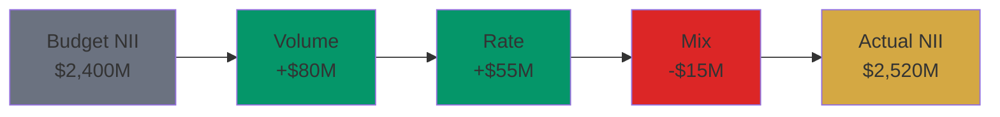

# Variance Analysis Agent — Autonomous EPM-Connected Intelligence

## Agent Overview

An autonomous agent that connects to Oracle EPM Cloud (EPBCS/FCCS) via MCP protocol,
extracts financial data, decomposes variances using industry-specific drivers, generates
executive-quality commentary, and produces MBR-ready reports — all without human intervention.

---

## Agent Workflow

```
┌─────────────────────────────────────────────────────────────────────┐
│                 VARIANCE ANALYSIS AGENT WORKFLOW                      │
├─────────────────────────────────────────────────────────────────────┤
│                                                                      │
│  STEP 1: EXTRACT                                                     │
│  ┌────────────────────────────────────────────────────────┐         │
│  │ oracle_epm MCP:                                         │         │
│  │   export_data(scenario="Actual", period="2026-Q1")     │         │
│  │   export_data(scenario="Budget", period="2026-Q1")     │         │
│  │   export_data(scenario="Forecast", period="2026-Q1")   │         │
│  │   export_data(scenario="PriorYear", period="2025-Q1")  │         │
│  │   get_dimensions(dimension="Entity")                    │         │
│  │   get_members(dimension="Account", parent="P&L")       │         │
│  └────────────────────────────────────────────────────────┘         │
│                          │                                           │
│                                                                     │
│  STEP 2: COMPARE                                                     │
│  ┌────────────────────────────────────────────────────────┐         │
│  │ Calculate:                                              │         │
│  │   • $ variance = Actual - Budget                       │         │
│  │   • % variance = (Actual - Budget) / |Budget|          │         │
│  │   • Prior year growth = (Actual - PY) / |PY|           │         │
│  │   By: Entity, Account, Product, Channel                │         │
│  └────────────────────────────────────────────────────────┘         │
│                          │                                           │
│                                                                     │
│  STEP 3: DECOMPOSE (industry-specific)                               │
│  ┌────────────────────────────────────────────────────────┐         │
│  │ Apply decomposition models per P&L line:                │         │
│  │   Banking NII: Volume × Rate × Mix                     │         │
│  │   Insurance Premium: Volume × Price × Retention         │         │
│  │   Asset Mgmt: AUM × Fee Rate × Performance             │         │
│  │   See detailed models below...                          │         │
│  └────────────────────────────────────────────────────────┘         │
│                          │                                           │
│                                                                     │
│  STEP 4: GENERATE COMMENTARY                                         │
│  ┌────────────────────────────────────────────────────────┐         │
│  │ LLM generates per-line executive narrative:             │         │
│  │   • What happened (quantified)                         │         │
│  │   • Why it happened (driver attribution)               │         │
│  │   • What's the outlook (forward-looking)               │         │
│  │   • Management action required (if material)           │         │
│  └────────────────────────────────────────────────────────┘         │
│                          │                                           │
│                                                                     │
│  STEP 5: VALIDATE                                                    │
│  ┌────────────────────────────────────────────────────────┐         │
│  │ Policy engine checks:                                   │         │
│  │   • Are variances properly classified (one-time vs      │         │
│  │     recurring)?                                         │         │
│  │   • Do revenue recognition treatments comply with       │         │
│  │     IFRS 15 / ASC 606?                                 │         │
│  │   • Are provision movements consistent with ECL model?  │         │
│  └────────────────────────────────────────────────────────┘         │
│                          │                                           │
│                                                                     │
│  STEP 6: REPORT                                                      │
│  ┌────────────────────────────────────────────────────────┐         │
│  │ Produce MBR-ready output:                               │         │
│  │   • Executive summary (top 5 variances)                │         │
│  │   • Waterfall/bridge charts (Mermaid)                  │         │
│  │   • Detailed variance tables                           │         │
│  │   • Commentary per P&L line                            │         │
│  │   • Risk flags and management actions                  │         │
│  └────────────────────────────────────────────────────────┘         │
│                                                                      │
└─────────────────────────────────────────────────────────────────────┘
```

---

## MCP Tool Invocations

| Step | MCP Server | Tool | Parameters | Purpose |
|------|-----------|------|------------|---------|
| Extract | oracle_epm | `export_data` | scenario, period, entity, account_filter | Pull actual/budget/forecast data |
| Extract | oracle_epm | `get_dimensions` | dimension_name | Get entity/account hierarchy |
| Extract | oracle_epm | `get_members` | dimension, parent, level | Get account tree for P&L structure |
| Extract | oracle_epm | `run_business_rule` | rule_name="Calculate_Variance" | Trigger server-side variance calc |
| Validate | oracle_epm | `get_job_status` | job_id | Confirm data export completed |
| Report | oracle_erp | `run_sql_query` | SQL for GL balance confirmation | Cross-check EPM to ERP GL |

---

## Industry-Specific Decomposition Models

### 1. Banking — P&L Variance Decomposition

#### Net Interest Income (NII)

```
NII VARIANCE DECOMPOSITION:

Total NII Variance = Volume Effect + Rate Effect + Mix Effect + Day Count

Volume Effect:
  ΔVolume × Budget Rate × Budget Mix
  = (Actual Avg Balance - Budget Avg Balance) × Budget Yield/Cost

Rate Effect:
  Budget Volume × ΔRate × Budget Mix
  = Budget Avg Balance × (Actual Yield/Cost - Budget Yield/Cost)

Mix Effect:
  Budget Volume × Budget Rate × ΔMix
  = Shift in portfolio composition (fixed vs floating, term structure)

EXAMPLE (Canadian Bank, Q1 2026):
  Budget NII: $2,400M
  Actual NII: $2,520M
  Favorable Variance: $120M
    Volume Effect: +$80M (loan growth 4% above plan)
    Rate Effect: +$55M (prime rate held higher than forecast)
    Mix Effect: -$15M (shift to lower-margin variable rate)
```

#### NII Sub-Drivers

| Driver | Decomposition | Data Source |
|--------|--------------|-------------|
| Loan Volume | New originations - Maturities - Prepayments | Core banking → EPM |
| Deposit Volume | New accounts + Balance growth - Attrition | Core banking → EPM |
| Lending Rate | Benchmark (CORRA/SOFR) + Credit spread + Liquidity premium | Treasury → EPM |
| Funding Cost | Deposit rate + Wholesale funding + Term premium | Treasury → EPM |
| NIM | (Interest Income - Interest Expense) / Avg Earning Assets | Calculated in EPM |

#### Non-Interest Revenue

```
FEE INCOME VARIANCE:
  Card Fees: Volume (transactions) × Price (interchange rate) × Mix (credit vs debit)
  Wealth Fees: AUM × Fee Rate × Performance Fee
  Service Charges: Accounts × Fee Schedule × Waiver Rate
  Trading Revenue: Notional × Spread × Volatility Factor
  FX Revenue: Volume × Margin × Market Volatility
```

#### Provision for Credit Losses (PCL)

```
PCL VARIANCE:
  Stage 1: ΔExposure × 12M PD × LGD (performing book)
  Stage 2: ΔSICR migrations × Lifetime PD × LGD
  Stage 3: New impairments + Write-offs - Recoveries
  Overlay: Management adjustment (forward-looking)

DECOMPOSITION:
  Model-driven: Changes in PD/LGD parameters (macro scenarios)
  Volume-driven: Portfolio growth/decline
  Migration-driven: Stage 1→2→3 movements
  Write-off timing: Actual vs expected charge-offs
```

#### Non-Interest Expense (NIE)

```
NIE VARIANCE:
  Compensation: Headcount × Avg Salary × Benefits Load
  Technology: Run-the-Bank + Change-the-Bank + Amortization
  Occupancy: Square footage × Rate + Maintenance + Property Tax
  Professional Fees: Project hours × Blended Rate
  Regulatory: Compliance FTE + Exam costs + Remediation
  Marketing: Campaign spend + Digital + Brand
```

### 2. Insurance — P&L Variance Decomposition

#### Gross Written Premium (GWP)

```
GWP VARIANCE:
  Volume Effect: ΔPolicies × Budget Avg Premium
  Price Effect: Budget Policies × ΔAvg Premium (rate adequacy)
  Retention Effect: Δ(Renewal Rate) × Budget In-Force Premium
  New Business: New policies × Avg premium (growth channel)
  Mix Effect: Shift between product lines (Auto vs Property vs Liability)

EXAMPLE (illustrative P&C insurer, one quarter):
  Budget GWP: $100M
  Actual GWP: $108M
  Favorable Variance: $8M
    Rate Increases: +$6M (hardening market, avg +5% on renewals)
    Retention: +$1.5M (retention improved 92% → 93.5%)
    New Business: +$3M (digital channel growth)
    Mix: -$2.5M (growth concentrated in lower-premium personal lines)
```

#### Loss Ratio

```
LOSS RATIO VARIANCE (Claims / Earned Premium):
  Frequency Effect: Δ(Claims Count / Policies) × Budget Avg Severity
  Severity Effect: Budget Frequency × Δ(Avg Claim Cost)
  Large Loss Effect: Cat events + Individual large losses > threshold
  Reserve Development: Prior-year strengthening or releases
  IBNR Adjustment: Change in actuarial IBNR estimate

COMBINED RATIO = Loss Ratio + Expense Ratio
  Target: <95% (underwriting profit)
  Actual vs Budget decomposition by line of business
```

#### IFRS 17 Insurance Revenue

```
INSURANCE REVENUE VARIANCE:
  CSM Release: ΔCoverage units × Amortization pattern
  Risk Adjustment Release: Service provided in period
  Expected Claims: Incurred claims vs initial estimate
  Loss Component: Onerous contract identification

  Insurance Revenue = Expected Claims + RA Release + CSM Release
  Variance driven by: Earning pattern, new business, assumption changes
```

### 3. Credit Unions — Variance Decomposition

```
CREDIT UNION P&L STRUCTURE:
  Net Interest Income: Member loans vs member deposits (spread)
  Fee Income: NSF fees, interchange, mortgage fees, insurance commissions
  PCL: Delinquency-driven (consumer focus: auto, mortgage, LOC)
  Operating Expense: Branch network + Centralized services
  Patronage/Dividends: Return to members (cooperative model)

UNIQUE DRIVERS:
  Member Growth: ΔMembers × Revenue/Member
  Loan-to-Deposit Ratio: Target 80-90% (liquidity vs profitability)
  Operating Efficiency Ratio: NIE / (NII + Non-Interest Revenue) target <70%
```

### 4. Asset Management — Variance Decomposition

```
ASSET MANAGEMENT REVENUE:
  Management Fees: AUM × Basis Points (fund-specific)
  Performance Fees: Excess return × Crystallization rate × HWM
  Distribution Fees: AUM × Trailer fee rate
  Transaction Fees: Trade volume × Per-trade fee

AUM VARIANCE:
  Market Effect: Opening AUM × Market Return
  Flow Effect: Net Sales (Gross Sales - Redemptions)
  FX Effect: Non-domestic AUM × ΔFX Rate
  Performance Effect: Alpha generation vs benchmark

EXAMPLE:
  Budget AUM: $250B → Revenue $1,875M (75bps avg)
  Actual AUM: $270B → Revenue $2,025M
    Market Effect: +$15B (equity rally Q1)
    Net Flows: +$5B (institutional mandates won)
    Basis Point Impact: Flat (no fee compression)
```

### 5. Pension Funds — Variance Decomposition

```
PENSION FUND VARIANCE:
  Investment Return: Actual vs Policy Benchmark
    Asset Allocation Effect: Δ(Weights) × Benchmark Returns
    Selection Effect: Actual Weight × (Manager Return - Benchmark)
    Currency Effect: Unhedged FX exposure × ΔFX

  Liability Movement:
    Discount Rate: Duration × Δ(Discount Rate)
    Demographic: Mortality improvement, turnover, retirement age
    Salary Growth: Projected vs actual wage inflation

  Funded Status: Assets / PV(Liabilities)
    Target: 100%+ funded
    Variance: Asset return - Liability growth = Δ(Funded Ratio)
```

---

## Commentary Generation Patterns

### Executive Summary Template

```
VARIANCE COMMENTARY STRUCTURE:

HEADLINE: [Entity] [Period] [P&L Line] was [Favorable/Unfavorable] by
$[X]M ([Y]%) vs [Budget/Forecast/PY]

DRIVER ATTRIBUTION:
"The $[X]M [favorable/unfavorable] variance was primarily driven by:
 1. [Primary driver] ($[A]M, [%] of total) — [one-sentence explanation]
 2. [Secondary driver] ($[B]M) — [one-sentence explanation]
 3. [Offsetting factor] (-$[C]M) — [one-sentence explanation]"

OUTLOOK:
"[Forward-looking statement about sustainability/trend]"

MANAGEMENT ACTION (if material):
"[Required action and timeline, if variance exceeds threshold]"
```

### Materiality Thresholds

| Industry | $ Threshold | % Threshold | Escalation |
|----------|-------------|-------------|------------|
| Banking (D-SIB) | $25M | 5% | CFO review |
| Banking (Mid-tier) | $5M | 5% | Controller review |
| Insurance (Large) | $10M | 3% | Chief Actuary + CFO |
| Credit Union | $500K | 5% | CEO + Board |
| Asset Management | $2M | 3% | CIO review |
| Pension Fund | $50M (assets) | 50bps (funded ratio) | CIO + Trustees |

---

## Report Output Format

### Waterfall Chart (Mermaid)



### Variance Summary Table (Output Format)

| P&L Line | Actual | Budget | Var $ | Var % | Primary Driver | Status |
|----------|--------|--------|-------|-------|---------------|--------|
| Net Interest Income | $2,520M | $2,400M | +$120M | +5.0% | Loan volume growth |  Favorable |
| Fee Income | $680M | $720M | -$40M | -5.6% | Wealth AUM decline |  Watch |
| Total Revenue | $3,200M | $3,120M | +$80M | +2.6% | NII strength |  Favorable |
| PCL | -$380M | -$320M | -$60M | -18.8% | Stage 2 migration |  Unfavorable |
| NIE | -$1,800M | -$1,850M | +$50M | +2.7% | Hiring delays |  Favorable |
| **Net Income** | **$1,020M** | **$950M** | **+$70M** | **+7.4%** | |  |

---

## Configuration

### Agent Parameters

```json
{
  "agent_id": "variance-analysis-agent",
  "mcp_servers": ["oracle_epm", "oracle_erp"],
  "parameters": {
    "comparison_scenarios": ["Budget", "Forecast", "PriorYear"],
    "decomposition_level": "detailed",
    "commentary_style": "executive",
    "materiality_threshold_pct": 5.0,
    "materiality_threshold_abs": 5000000,
    "include_forward_looking": true,
    "output_format": ["summary_table", "waterfall", "detailed_narrative"],
    "languages": ["en"],
    "sign_convention": "favorable_positive"
  },
  "industry_config": {
    "banking": {
      "nii_decomposition": ["volume", "rate", "mix", "day_count"],
      "pcl_decomposition": ["stage_migration", "model_driven", "volume", "write_off"],
      "nie_categories": ["compensation", "technology", "occupancy", "other"]
    },
    "insurance": {
      "premium_decomposition": ["volume", "price", "retention", "new_business", "mix"],
      "claims_decomposition": ["frequency", "severity", "large_loss", "reserve_dev"],
      "combined_ratio_target": 0.95
    },
    "asset_management": {
      "aum_decomposition": ["market", "flows", "fx", "performance"],
      "fee_decomposition": ["mgmt_fee", "performance_fee", "distribution", "transaction"]
    }
  }
}
```

### Scheduling

| Trigger | Frequency | Scope | Recipient |
|---------|-----------|-------|-----------|
| Period close (EPM data available) | Monthly | Full P&L by entity | Finance leadership |
| Flash estimate (T+3) | Monthly | Top-line revenue + costs | CFO |
| Board pack | Quarterly | Consolidated + segment | Board / Audit Committee |
| Ad-hoc | On-demand | Specific line item deep-dive | Budget owners |

---

## Cross-References

- **Reconciliation Agent** — Uses reconciliation outputs to confirm GL→EPM tie-out before variance analysis
- **Journal Entry Agent** — May trigger correcting entries if variance reveals misposting
- **Accounting Policy Engine** — Validates that revenue/cost recognition complies with standards
- **Oracle EPM Wiki** — EPBCS/FCCS module reference for EPM data model and business rules
- **Oracle ERP Wiki** — GL/SLA configuration that feeds EPM data